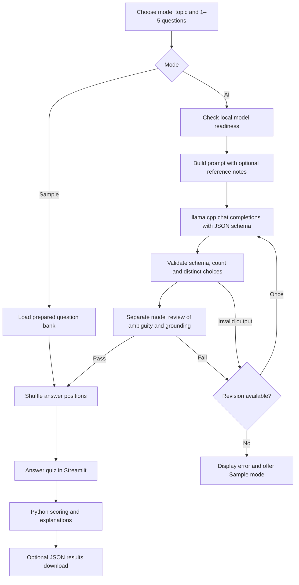

# 99 Learn — local employee quiz generator

A Streamlit app for 99 Group employees: enter a topic, generate a short quiz with the installed **Gemma 4 12B QAT** model through **llama.cpp**, answer four-choice questions, and review your score with explanations. Three prepared topics work without a model or internet connection.

The whole application runs on your computer. No cloud model, API key, database, or external content service is required at runtime. This is an assessment prototype inspired by 99 Group, not an official company product.

## Run on this prepared computer: two terminals, two commands

Open two PowerShell terminals in **`assesment/project-c`**. The project environment and dependencies have already been installed here.

**Terminal 1 — start the installed model:**

```powershell
powershell -NoProfile -ExecutionPolicy Bypass -File .\start-llama.ps1
```

Wait until it prints `model loaded` and `listening on http://127.0.0.1:8080`.

**Terminal 2 — start the app:**

```powershell
powershell -NoProfile -ExecutionPolicy Bypass -File .\start-web.ps1
```

Open **http://127.0.0.1:8501**. Keep both terminals running; **Ctrl+C** stops each server. Sample mode needs only Terminal 2. Port 8080 is the model server; port 8501 is the quiz app.

## First-time setup on another computer

Requirements: Windows PowerShell, Python 3.11 or newer, Git, and a recent llama.cpp build supporting the installed Gemma model, `--jinja`, `--reasoning off`, and JSON schema responses. Put `llama-server` on PATH. The model and llama.cpp are not bundled in this repository.

From the project directory, run this once:

```powershell
powershell -NoProfile -ExecutionPolicy Bypass -File .\setup.ps1
```

This creates a separate `.venv` and installs the pinned application and test dependencies. It uses `uv` when available, otherwise Python's venv and pip. If Python is not discoverable, pass `-PythonPath 'C:\path\to\python.exe'`. Internet is normally needed for dependency installation; it is not needed for subsequent quizzes.

The model launcher looks for your existing file named `gemma-4-12B-it-qat-UD-Q4_K_XL.gguf` in the Hugging Face cache. To use an installed GGUF elsewhere:

```powershell
powershell -NoProfile -ExecutionPolicy Bypass -File .\start-llama.ps1 -ModelPath 'D:\models\gemma-4-12B-it-qat-UD-Q4_K_XL.gguf'
```

The launcher never downloads a model. It sets alias `gemma-4-12b`, loopback address `127.0.0.1`, port 8080, 8192 context tokens, one inference slot, GPU offload, and thinking disabled. It uses batches of 256 / microbatches of 128 and disables prompt caching/checkpoints. The process-local environment variable `GGML_VK_DISABLE_GRAPH_OPTIMIZE=1` avoids a reproduced NVIDIA-driver crash in this installed Vulkan build. It is restored when the launcher exits; it changes no driver settings. See the verification report for the observations and limits.

GPU support and speed depend on your llama.cpp build and hardware. A CPU fallback is available as `start-llama.ps1 -CpuOnly`; it can be slower and has not been benchmarked. The equivalent base command is:

```powershell
llama-server --model 'D:\models\your-model.gguf' --alias gemma-4-12b --host 127.0.0.1 --port 8080 --ctx-size 8192 --parallel 1 --gpu-layers 0 --device none --jinja --reasoning off --no-cache-prompt --cache-ram 0 --ctx-checkpoints 0 --batch-size 256 --ubatch-size 128
```

macOS/Linux: create and activate a Python 3.11+ virtual environment, `python -m pip install -r requirements-dev.txt`, start an equivalent `llama-server` command, and run `python -m streamlit run app.py`. PowerShell launchers are Windows conveniences.

## Use the app

1. Choose **AI mode** or **Sample mode**. When the model is unavailable, Sample mode is the initial selection. You can choose it while the model is running too.
2. In AI mode, type any topic and optionally paste reference notes. In Sample mode, select one of the three prepared topics.
3. Choose **1–5 questions**, then generate or start the sample.
4. Select one answer per question and submit. An incomplete form stays open and asks you to answer every question.
5. Review the score, correct options, your answers, and one- or two-sentence explanations. Download the review as JSON, or create another quiz.

The answer order is shuffled while preserving the answer key. A new quiz clears prior answer selections. Returning to setup preserves your existing quiz until a replacement succeeds. Submitted results stay fixed; scoring and downloads make no model calls.

### The three sample topics

| Topic | Questions available | Content |
| --- | ---: | --- |
| Property agent skills | 5 | Qualification, conversion rates, verification, communication, AI fact checking |
| Reading a Jakarta market briefing | 5 | Percentage changes, enquiry ratios, data coverage, asking vs sale prices |
| Property numbers & playful puzzles | 5 | Area, viewing schedules, hypothetical rental yield, matching requirements, listing views |

The Jakarta sample uses a **clearly labelled fictional briefing** displayed above the questions. It is not a real market report. All 15 questions, choices, keys, explanations, and briefings are readable in [data/samples.json](data/samples.json).

### Topics about current market updates

The local model has **no browsing, retrieval, or live data feed**. For `property market updates in Jakarta`, paste a dated, reliable briefing into **Add source notes**. URLs alone are not opened. The quiz retains those notes so the learner can read them alongside the questions.

Without notes, the prompts require general concepts and explicitly hypothetical scenarios. A year in a topic does not turn the model into a current-news source. Supplied notes are assumed accurate; the app does not independently verify them. [examples/jakarta-briefing.txt](examples/jakarta-briefing.txt) provides a synthetic demonstration you can paste without misrepresenting it as news.

## How generation works



- `GET /health` and `GET /v1/models` establish readiness and the configured model alias. Status is cached for 15 seconds; **Refresh model status** checks again.
- `POST /v1/chat/completions` uses a JSON schema with the exact requested count, four options, a `correct_answer` string matching one option, and an explanation. Python derives the integer answer key (0–3); the model does not have to count option positions correctly.
- Python rejects duplicate questions, duplicate/empty choices, invalid indices, extra fields, wrong counts, and incomplete responses.
- A separate completion audits each question's stated criterion, plausible alternative answers, arithmetic, and support for current facts. Python requires one audit for every question and exactly one defensible index matching its answer key; an overall approval flag alone is insufficient. A rejected or malformed quiz gets **one revision**. There are at most four completions: generation, review, revised generation, revised review.
- Connection, timeout, and HTTP failures display safe, actionable messages. They do not silently substitute sample questions. The user chooses Sample mode explicitly after a failure.
- AI review reduces ambiguity but **cannot prove factual correctness or unique correctness**. A domain expert should review AI questions before using them for formal assessment. The prepared sample bank provides an inspectable alternative.

## Configuration

Defaults work without any configuration file. Optional environment variables must be set in the app's terminal **before** starting Streamlit:

```powershell
$env:LLAMA_BASE_URL = 'http://127.0.0.1:8080/v1'
$env:LLAMA_MODEL = 'gemma-4-12b'
$env:LLAMA_TIMEOUT = '120'
```

Only loopback HTTP model URLs ending in `/v1` are accepted. Model requests bypass proxy environment settings. The connection timeout is 3 seconds and read timeout defaults to 120 seconds **per request**, configurable from 5 to 300. A revision can therefore take longer than one timeout window.

If ports are occupied, use `start-web.ps1 -Port 8504` or `start-llama.ps1 -Port 8081`; for the latter also set `LLAMA_BASE_URL` to `http://127.0.0.1:8081/v1` in the app terminal.

### Open on a phone on the same Wi-Fi

The layout uses responsive widths and a single-column quiz flow. Start the web app with:

```powershell
powershell -NoProfile -ExecutionPolicy Bypass -File .\start-web.ps1 -Lan
```

Find the PC's local IPv4 address with `ipconfig`, then open `http://YOUR_PC_IP:8501` on your phone. Both devices must be on the same network; Windows Firewall may need to allow the Python app on the private network. The LLM remains on the PC's loopback interface. LAN mode has no login and is for a trusted local demo. Default startup stays local to the PC. The app is not a deployment for 99 simultaneous users; inference is configured for one slot.

## Verify

Offline automated checks:

```powershell
.\.venv\Scripts\python.exe -m pytest -q --basetemp .pytest_cache/tmp
```

One real local-model check, after starting llama-server:

```powershell
.\.venv\Scripts\python.exe live_check.py --topic 'Top skills of a property agent in 2026' --count 5
```

It saves `examples/live-quiz.json` on success. To supply notes, use `--notes-file examples/jakarta-briefing.txt`. For the three documented integration cases, run `.\.venv\Scripts\python.exe scripts/verify_live.py`; this makes real requests and saves successful examples. Diagnostic response traces stay in ignored `artifacts/`. The script uses only its public, synthetic fixture data. A real five-question example is included in [examples/live-agent-skills.json](examples/live-agent-skills.json).

See [TEST_REPORT.md](TEST_REPORT.md) for actual verification and limits. Programmatic perfect-score examples check scoring against the model's answer key; they are not employee attempts or an independent factual accuracy measurement.

The final build passed **55 offline tests** and three real local-model cases (1 and 5 questions). A real-model Streamlit AppTest also passed generation, answering, a deliberately mixed **1/2 score**, and the results-download check; rerun it with `.\.venv\Scripts\python.exe scripts/verify_live_app.py`. Browser and physical-phone visual checks could not be completed in this environment.

## Project map

```text
app.py                 Streamlit screens and session state
quiz.py                Validated data contract, shuffling, scoring, export
generator.py           Local API calls, bounded revision, quality review
settings.py            Local-only environment configuration
samples.py             Offline bank loader
data/samples.json      3 topics × 5 questions
prompts/               Actual system, user and reviewer prompt text
assets/style.css       Responsive visual styling
start-web.ps1          Web launcher (optional LAN access)
start-llama.ps1        Existing GGUF launcher
setup.ps1              One-time environment installation
tests/                 Domain, model adapter and Streamlit interaction tests
examples/              Briefing and inspectable output evidence
scripts/verify_live.py Repeatable live integration check
SUBMISSION_GUIDE.md    Assessment fields and actual prompts to paste
```

Quizzes and answers live in the browser's Streamlit session; a page reload or server restart can reset them. There is no employee tracking, account system, central results store, or quiz publishing. Reference notes are not included in ordinary results downloads. No model files, secrets, environment, or logs are committed.

## Design and technical references

99 Group's [official company page](https://www.99.co/about-us/indonesia) and [99.co Indonesia website](https://www.99.co/id) were accessible during research. Their property focus and emphasis on ease of use informed a blue-and-white learning interface with rounded panels, clear labels, and generous spacing. It is an original assessment interface, not a reproduction of a formal brand guide. Attempts to open [99 Indonesia on Instagram](https://www.instagram.com/99indonesia/) and [99 Group on Instagram](https://www.instagram.com/99group/) were unsuccessful; no Instagram assets were copied. No remote fonts or images are required.

The implementation follows the official [llama.cpp server API](https://github.com/ggml-org/llama.cpp/tree/master/tools/server), [Streamlit radio-widget API](https://docs.streamlit.io/develop/api-reference/widgets/st.radio), and [Streamlit app-testing API](https://docs.streamlit.io/develop/api-reference/app-testing). The model is the user's installed [Gemma 4 12B QAT GGUF](https://huggingface.co/unsloth/gemma-4-12B-it-qat-GGUF); the repository does not redistribute it.

## Git and submission

This folder is a self-contained local Git repository. You manage the public GitHub repository and submission. Publish **this folder's contents**, not the wider Internship workspace, which contains unrelated personal material. Do not upload `.venv`, model weights, logs, or secrets.

After creating your empty public GitHub repo, use your own URL:

```powershell
git remote add origin https://github.com/YOUR_USERNAME/YOUR_REPO.git
git push -u origin main
```

Check the repository while signed out. The evaluator cannot open `localhost`; a local URL is a run instruction, not a public demo link. The public repo must contain the source, prompts, sample output, run instructions, and test report. [SUBMISSION_GUIDE.md](SUBMISSION_GUIDE.md) contains copyable field text and the actual prompts, so you can paste them directly into the assessment form. Edit the reflection into your own words and include only claims you can demonstrate.
